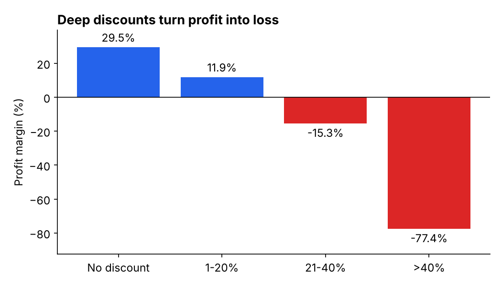
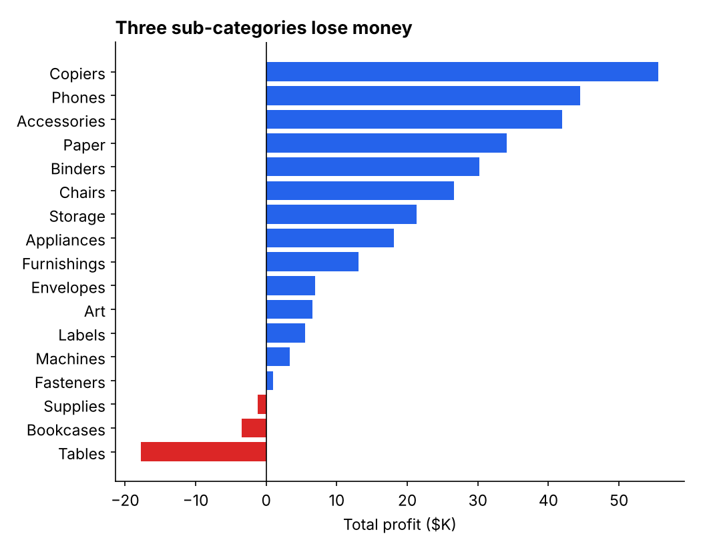
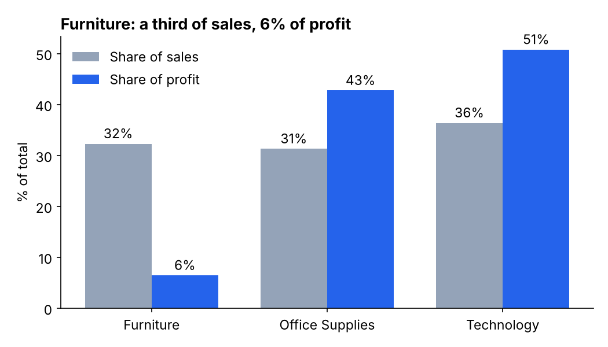
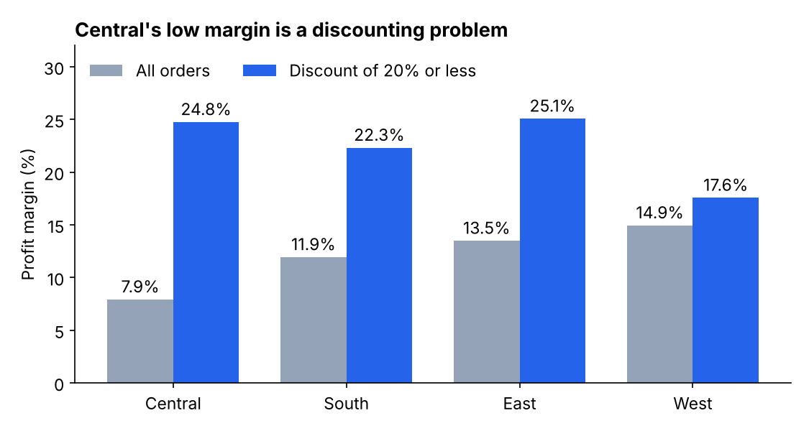
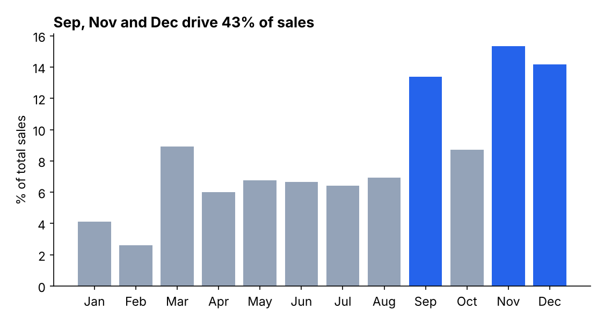

# ⚡ AI-Powered Sales Analytics Dashboard

A modern, enterprise-grade business intelligence platform built with Python and Streamlit. This dashboard transforms raw sales data (CSV, Excel, JSON, Parquet) into actionable insights using machine learning, interactive visualizations, and Google's Generative AI (Gemini 2.5 Flash).

**🔗 Live demo:** https://sales-data-analysis-dashboard-vvxyh2oeu9qw26esr9vbdd.streamlit.app/

> The free-tier app sleeps when idle, so the first load can take up to a minute. Click **Load Enterprise Demo Data** in the sidebar to explore every feature without uploading a file.

## 🚀 Features

* **🔐 Secure Authentication**: Sign-up and login backed by SQLite, with passwords hashed using `bcrypt`. Includes an email-based password reset (6-digit code from `secrets`, stored hashed, expires in 10 minutes, 5 attempts, 60-second resend cooldown) and a persistent login via an HMAC-signed browser cookie that expires after 24 hours. Each user's theme preference is saved to their account.
* **📊 Interactive Dashboard**: KPI cards (total sales, profit or average order value, total orders), monthly sales trend, sales by category, regional performance, and top 10 products, all as Plotly charts styled to the active theme.
* **📈 Time-Series Forecasting**: Tests several models (repeat last week, weekday average, recent average and Meta's **Prophet**) on the most recent part of your own data and forecasts with the one that has the lowest error (WAPE). Choose a weekly view (default, 4 weeks ahead) or a daily view (30 days ahead). The page shows the forecast, a likely range, the measured error and a table of how every model scored.
* **⚠️ Anomaly Detection**: A scikit-learn **Isolation Forest** flags irregular sales days and highlights them on the daily sales line.
* **🎯 Customer Risk (RFM) Analysis**: Scores customers on Recency, Frequency, and Monetary value (terciles, 1–3). High-value customers with low recency are flagged as churn risks, with a risk level (low, intermediate, critical), revenue at risk, and a suggested action plan.
* **🤖 Generative AI**: Google Gemini 2.5 Flash generates business insights from dataset summary statistics, and a chat assistant answers plain-English questions by running real aggregations on your data through Gemini function calling (no model-written code is executed), with a "How this was calculated" panel showing each query and result.
* **📄 Automated Reporting**: Download the filtered dataset as CSV, an HTML executive summary, or a PDF executive report that embeds the dashboard charts.
* **🧩 Flexible Data Input**: Supports CSV, XLSX/XLS, JSON, and Parquet uploads, with a column-mapping panel that auto-detects sales, date, category, region, product, and customer columns. A one-click demo dataset is included for testing. Large tables are previewed (first 1,000 rows) with the full data available as a CSV download, and the PDF report is generated on demand.
* **🎨 Dynamic Theming Engine**: Custom CSS architecture that lets users switch between multiple premium dark UI themes instantly.

---

## 🔍 Key Findings (Superstore sample)

The numbers below come from `data/Sample - Superstore.csv` (9,994 order lines, Jan 2014 to Dec 2017, $2.30M sales, $286K profit, 12.5% overall margin). Charts are regenerated by `python Scripts/make_findings_charts.py`.

**1. Discounts above 40% destroy profit.** Orders with no discount earn a 29.5% margin. Above 40%, the margin is **-77.4%** (933 order lines, **-$99.6K** profit). The 21-40% band also loses money (-15.3%). *Action: cap discounts at 20%.*



**2. Three sub-categories lose money.** Tables lose **$17.7K** on $207K of sales (-8.6% margin), Bookcases lose $3.5K and Supplies lose $1.2K. Copiers, Phones and Accessories are the top three profit earners. *Action: reprice or stop discounting Tables and Bookcases.*



**3. Furniture is a third of sales but 6% of profit.** Furniture brings in 32% of sales but only 6% of profit (2.5% margin, versus about 17% for Office Supplies and Technology).



**4. Central's weak margin is a discounting problem, not a region problem.** Central's margin is 7.9% against 14.9% in West, but 27.7% of Central's order lines carry a discount above 20% (West: 3.7%). Excluding those lines, Central's margin rises to 24.8%, in line with East (25.1%) and South (22.3%). Texas, Ohio and Pennsylvania are the loss-making states.



**5. Sales are seasonal.** September, November and December make up 43% of annual sales. *Action: plan inventory and campaigns around Q4.*



*These are descriptive findings from one sample dataset. They show where profit is lost, not why customers buy; treat the actions as hypotheses to test.*

---

## 🗂️ Project Structure

| File | Purpose |
| :--- | :--- |
| `app.py` | Main Streamlit app: data loading, filters, dashboard, forecast page, RFM, AI features, and routing |
| `forecasting.py` | Forecast models, rolling backtest and automatic model choice (no Streamlit code, fully testable) |
| `auth.py` | User sign-up, login (bcrypt), password reset, reset email, and theme persistence (SQLite) |
| `security.py` | Signed login cookies (HMAC-SHA256) and expiring, attempt-limited one-time codes |
| `cleaning.py` | Data-cleaning step: duplicates, missing or invalid sales and dates, text trimming |
| `chat_agent.py` | Chat tool layer: safe `query_sales` aggregation that Gemini calls through function calling |
| `tests/` | `pytest` unit tests for the cleaning step and the forecasting module |
| `Scripts/` | Helper scripts: Online Retail II converter and the Key Findings chart generator |
| `images/findings/` | Charts used in the Key Findings section |
| `reports.py` | PDF executive report generation (FPDF + Plotly charts exported via Kaleido) |
| `styles.py` | Theme definitions and custom CSS |
| `model_training.ipynb` | Notebook used for Prophet model training and experimentation |
| `packages.txt` | System packages for deployment (Chromium, required by Kaleido for chart export) |
| `data/` | Sample data |

---

## 💻 Installation & Setup

**1. Clone the repository**
```bash
git clone https://github.com/KumarAadi9/Sales-Data-Analysis-Dashboard.git
cd Sales-Data-Analysis-Dashboard
```

**2. Install dependencies**
```bash
pip install -r requirements.txt
```

**3. Configure secrets**
To enable the Gemini features, you need a free Google Gemini API key.
* Get your key from [Google AI Studio](https://aistudio.google.com/app/apikey).
* Create a `.streamlit` folder in the root directory (if it does not exist).
* Create a file named `secrets.toml` inside that folder and add your key:
```toml
GEMINI_API_KEY = "your-api-key-here"
```
The key can also be provided as the `GEMINI_API_KEY` environment variable, or entered in the **Chat AI** tab for the current session.

To enable password-reset emails (sent through Gmail SMTP), also add a sender account to the same `secrets.toml`. Use a Gmail [App Password](https://support.google.com/accounts/answer/185833), not your normal password:
```toml
EMAIL_SENDER = "your-sender@gmail.com"
EMAIL_PASS = "your-gmail-app-password"
```

To keep logins safe, add a random key used to sign the login cookie. Generate one with `python -c "import secrets; print(secrets.token_hex(32))"`:
```toml
COOKIE_SECRET = "paste-the-generated-value-here"
```
If `COOKIE_SECRET` is missing, a random key is generated on each server start, so everyone is logged out whenever the app restarts.

> Never commit `secrets.toml` or the SQLite database to GitHub.

**4. Run the Application**
```bash
streamlit run app.py
```

No data handy? Click **Load Enterprise Demo Data** in the sidebar to try every feature.

---

## 📥 Input Data

For best results, your file should contain these columns (names are auto-detected and can be remapped in the sidebar):

| Column | Type | Used for |
| :--- | :--- | :--- |
| `order_date` | Date | Trends, forecasting, anomaly detection, RFM |
| `sales` | Number | All KPIs and models |
| `profit` | Number | Profit KPI (optional) |
| `region` | Text | Regional performance and filters |
| `category` | Text | Category breakdown and filters |
| `customer_id` | Text/Number | RFM and churn analysis |

---

## 🛠️ Technologies Used

* **Frontend / Framework**: Streamlit, Custom CSS
* **Data Processing**: Pandas, NumPy
* **Data Visualization**: Plotly Express, Plotly Graph Objects
* **Machine Learning**: Prophet and simple baselines with automatic model selection (forecasting), scikit-learn (Isolation Forest anomaly detection)
* **Artificial Intelligence**: Google Generative AI (`gemini-2.5-flash`)
* **Authentication & Storage**: SQLite, bcrypt, streamlit-cookies-controller
* **Reporting**: FPDF, Kaleido (Plotly static image export)

---

## ✅ Validation & Limitations

- **Forecast accuracy (measured in the app's own code):** on `data/Sample - Superstore.csv`, a rolling test of 3 held-out 30-day periods gives a daily error (WAPE) of about 68% for Prophet, 71% for the weekday average and 81-89% for the other baselines. Daily sales are very noisy, so no model does well. At weekly level (4 weeks ahead, 4 tests) the best model's error is about 33%. Prophet and a simple recent average score almost the same there, so the app uses whichever scores lower on your data. On this dataset the new setup is **not** more accurate than the earlier Prophet-only setup in daily mode (68.4% vs 67.9%); the gain is that the app now measures its own error, shows it, and defaults to the weekly view. Forecasts on sparse data should be treated as directional, not precise.
- **Missing days** are counted as 0 sales when building the daily series.
- **Scale:** Data is processed in memory with Pandas, and the free Streamlit Cloud tier has limited memory, so very large files (hundreds of thousands of rows) are best run locally. DuckDB is listed under future improvements.
- **Security notes:** Reset codes expire after 10 minutes, are stored hashed and allow 5 attempts. The login cookie is HMAC-signed and expires after 24 hours. Known limits: logout and password reset do not revoke a cookie that was already copied (no server-side session store), and the resend cooldown is tracked per browser session, not per account or IP.

---

## 🧪 Large-Scale Test (1M+ rows)

The dashboard was tested locally on the public **Online Retail II** dataset (1,067,371 raw transaction rows).

1. Download Online Retail II (Kaggle or UCI) as a CSV.
2. Convert it to the dashboard's column layout (computes `sales = Quantity × Price`, keeps every row):
```bash
   python Scripts/prepare_retail_data.py online_retail_II.csv retail_raw_1M.csv
```
3. Upload `retail_raw_1M.csv` in the app. The built-in cleaning step reports what it removed.

| Metric | Result |
| :--- | :--- |
| Raw rows ingested | 1,067,371 |
| Duplicate rows removed | 34,542 |
| Zero or negative sales removed | 25,110 |
| Rows analysed | 1,007,719 |

All tabs (Dashboard, AI Insights, Forecast, Risk, Chat AI, Data & Reports) worked on this file when run locally. The free Streamlit Cloud tier has limited memory, so very large files are best run on your own machine. The dataset has no product category, so the script reuses country for the category chart.

## 🧪 Tests

```bash
pip install pytest
pytest
```
Nine tests: three cover `clean_data` (duplicate removal, dropping missing and non-positive sales with the report adding up, trimming text without corrupting numeric IDs) and six cover forecasting (filling missing days, WAPE, the weekday pattern, the backtest, and too-little-data errors). The login, chat and report code have no automated tests.

---

## 🔮 Future Improvements

- [ ] Transition from in-memory Pandas processing to `DuckDB` for handling datasets > 1 million rows.
- [ ] Migrate user storage from SQLite to PostgreSQL for multi-user production use.
- [ ] Add server-side sessions so logout and password reset can revoke a login, and rate-limit reset requests per account.
- [ ] Add holiday regressors and an ETS or ARIMA model to the forecast comparison.
- [ ] Add a LightGBM model with lag features as another candidate.

---
*Designed for modern data analytics and professional portfolio demonstration.*
